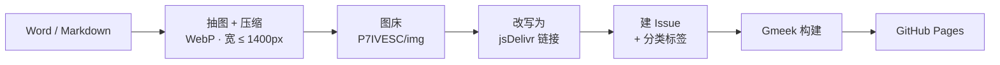

# 知其黑，守其白

**一个网安小白的红队实战、靶场复盘与学习笔记**

[🌐 博客](https://p7ivesc.github.io/) ｜ [🛡 EduSRC 主页](https://src.sjtu.edu.cn/profile/42619/) ｜ [📡 RSS 订阅](https://p7ivesc.github.io/rss.xml)

---

## 👋 关于这里

这里放的都是**自己真的跑过一遍**的东西：有授权的真实测试、靶场里翻过的车、以及事后才想明白的那些细节。

写不明白的不发，没复现的不发。

## 📝 写什么

| 分类 | 放什么 | 大概长这样 |
| --- | --- | --- |
| **渗透实战** `PENTEST` | 有授权的真实目标测试报告，从信息收集到权限获取的完整链路 | Web 漏洞利用、后渗透、痕迹清理 |
| **靶场复盘** `LABS` | VPC、靶机与在线练习环境的通关记录，重在思路而不是答案 | Upload-Labs、CMS 靶场、内网横向 |
| **学习笔记** `NOTES` | 环境搭建、协议原理、工具用法这类成体系的整理 | 域控部署、域渗透、隧道与代理 |

## ✨ 站点特色

- **卡片首页**：自动抓取每篇的首图与摘要，按分类分区展示
- **分类即标签**：分类就是 Issue 的 label，`tag.html` 自动聚合，发完文章顺手改标签就能换分类
- **文章页**：目录、阅读进度条、图片点击放大、上一篇 / 下一篇
- **实时统计**：文章数、正文总字数、配图总数
- **明暗主题**：跟随系统，也可手动切换
- **RSS 订阅**：`/rss.xml`，不用注册、不留邮箱
- **移动端适配**：卡片单列、侧栏收起、长副标题自动折行

## ⚙️ 技术栈

没有数据库、没有后端、没有构建依赖：

| 环节 | 用的什么 |
| --- | --- |
| 内容 | GitHub Issues —— 一篇 Issue 就是一篇文章 |
| 生成 | [Gmeek](https://github.com/Meekdai/Gmeek) v2.25 |
| 构建 / 托管 | GitHub Actions + GitHub Pages |
| 图床 | 独立仓库 [P7IVESC/img](https://github.com/P7IVESC/img)，jsDelivr CDN 分发 |
| 主题 | 手写 `theme.css` + `app.js`，通过 `config.json` 的 `allHead` 注入所有页面 |

## ✍️ 一篇文章是怎么发出来的

Word 或 Markdown 丢进脚本跑一遍，剩下的交给流水线：

docx 里塞几十张图也不用一张张传：图片按内容摘要命名，重跑不会重复上传；发布失败会自动退避重试，
同标题文章不会发成两篇。一篇文章从拖进文件夹到上线，一两分钟。

## 📂 仓库

| 仓库 | 作用 |
| --- | --- |
| [P7IVESC.github.io](https://github.com/P7IVESC/P7IVESC.github.io) | 站点本体：文章（Issues）+ 主题 + 构建产物 |
| [img](https://github.com/P7IVESC/img) | 图床，文章配图都在这里 |

## 🔗 找到我

- 博客：<https://p7ivesc.github.io/>
- 漏洞报告平台主页（EduSRC）：<https://src.sjtu.edu.cn/profile/42619/>
- 技术交流请备注来源；联系方式放在博客副标题末尾（base64，防爬）

## ⚠️ 免责声明

站内全部技术内容仅用于**已获授权**的安全测试与自建学习环境。请勿将文中任何方法用于未授权的目标，
因此产生的一切后果与本人无关。

## 📄 版权

- **文章与配图**版权归 P7IVESC 所有，未经授权**禁止转载、搬运、摘编到其他平台**，也不得用于商业用途。
  需要转载请通过博客或 GitHub Issues 联系。
- **主题代码**（`theme.css` / `app.js`）欢迎参考，使用请保留出处。
